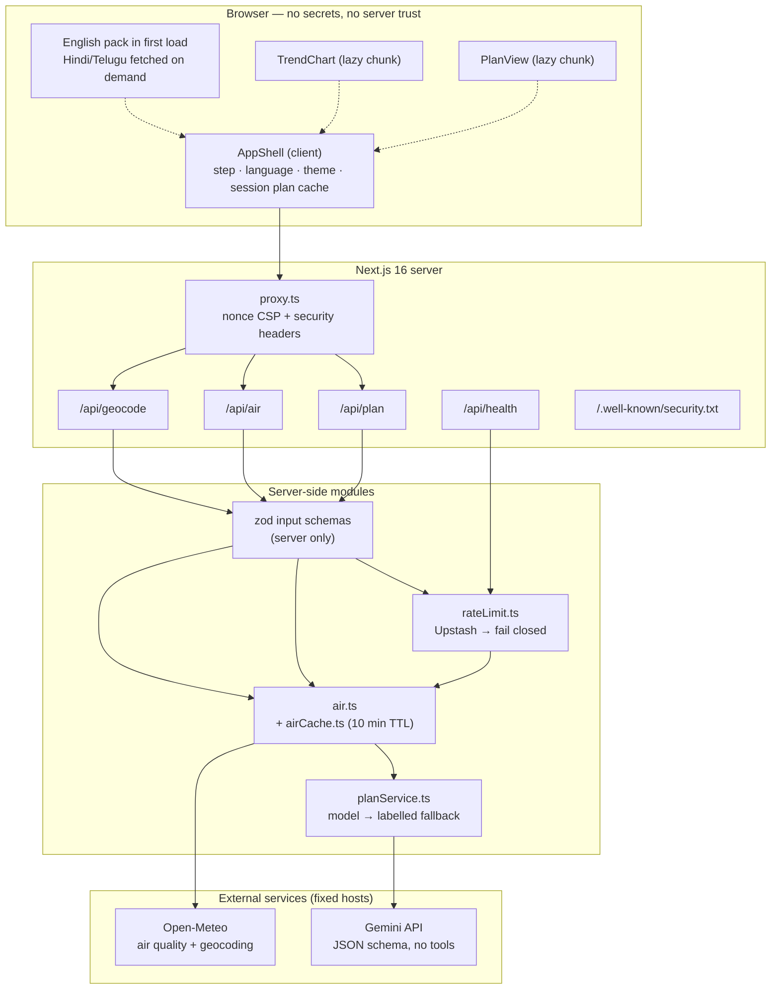
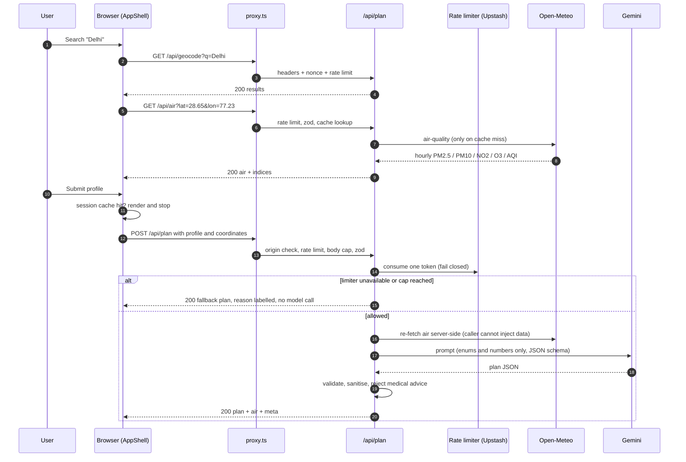

## Architecture



```
                       ┌──────────────────────────────────────────┐
 browser (no secrets)  │  React client (app-shell, plan-view)     │
                       │  · profile stays in React state          │
                       │  · regional + impact layers run locally  │
                       └───────────────┬──────────────────────────┘
                                       │ same-origin fetch only (connect-src 'self')
                       ┌───────────────▼──────────────────────────┐
                       │  Next.js route handlers (server)         │
                       │  /api/geocode  /api/air  /api/plan       │
                       │  /api/health   /.well-known/security.txt │
                       │  · origin + IP + size checks             │
                       │  · rate limit → fail closed              │
                       │  · zod validation, no free text          │
                       └───────┬───────────────────────┬──────────┘
                               │ fixed hosts           │ fixed host, key in header
                    ┌──────────▼─────────┐   ┌─────────▼──────────────┐
                    │ Open-Meteo (CAMS)  │   │ Gemini (server-side)   │
                    │ air + geocoding    │   │ JSON schema, no tools  │
                    └────────────────────┘   └────────────────────────┘
                               │
                    deterministic fallback planner (always available,
                    labelled with its reason: timeout, cap, disabled…)
```

Admin/build notes: headers and CSP are built per request in `src/proxy.ts`, the
service worker never touches `/api/`, and the deployment builds with no
`.env.local` so no secret can be baked into the bundle.

### Data flow for one plan



---


## How it works

1. **Location** — city search through Open-Meteo Geocoding, or browser geolocation
   _only after_ an explicit consent panel. Coordinates are rounded to 2 decimals
   (~1.1 km) before any API call and are never logged or stored.
2. **Quick profile** — household counts, sensitive-group toggles, home type,
   window/kitchen ventilation, commute mode, budget, room size. Held in React
   state only: a refresh clears it. Defined once as a zod schema shared by client
   and server, with **no free-text field** so nothing a user types can reach the
   model.
3. **Plan** — `/api/plan` re-fetches the air snapshot server-side, builds the
   prompt server-side, and returns either a validated AI plan or the
   deterministic fallback, clearly labelled.
4. **Ask about today’s plan** — six fixed quick questions (“Is it safe to walk
   to school today?”, “When should we open the windows?”) send an enum, never
   text. The same route, prompt rules, medical filter, script check and labelled
   fallback answer them.

### AQI standards

Both are shown, with source, timestamp and category **text next to the colour**
(colour is never the only indicator):

- **US EPA AQI** — `pm25UsAqi`, `pm10UsAqi`, interpolation over the 2024-revised
  breakpoint tables (`src/lib/air/aqi.ts`).
- **India CPCB NAQI** — sub-indices for PM2.5, PM10, NO₂ and O₃, overall index is
  the worst sub-index, prominent pollutant reported (`src/lib/air/naqi.ts`).

The NAQI figure carries a visible assumption: CPCB breakpoints are defined on
24-hour averages, while the app receives hourly model values.

### Fallback plan

`src/lib/ai/fallbackPlan.ts` + `src/lib/ai/planContent/` produce a full plan in
English, Hindi (Devanagari) and Telugu for all six severity bands. It is used
when the model is disabled, has no key, is over the daily cap, times out, is
rate limited, returns invalid JSON/schema, returns medication or diagnosis
content, or returns the wrong script. The UI says so, with a reason.

### Sample data

`src/lib/air/sampleData.ts` contains hand-written illustrative numbers. They are
used **only** when the user toggles demo mode, or when live air data could not be
fetched. Every surface that shows them carries a "Sample data" banner, and the
server also labels the plan response `sample: true`.

---

### Code conventions

- Limits, hosts and shared magic numbers live in `src/lib/shared/constants.ts`;
  routes, schemas and UI read the same value instead of repeating it.
- A fallible internal operation returns the shared `Result<T, E>`
  (`src/lib/shared/result.ts`), so callers branch on `ok` and handle the reason
  explicitly rather than relying on a thrown error or a nullable value.
- Files stay at 250 lines or fewer and functions at 40 lines or fewer, enforced
  by ESLint. Feature folders mirror the domain (`air/`, `ai/`, `security/`,
  `impact/`, `shared/`), and `npm run check:circular` / `npm run check:knip`
  keep the import graph and public surface clean.
